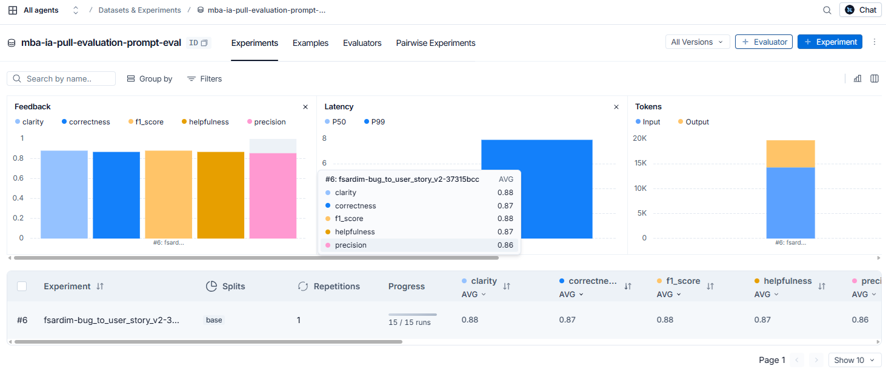
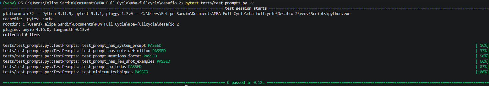

# Pull, Otimização e Avaliação de Prompts com LangChain e LangSmith

Projeto do Desafio 2 do MBA Full Cycle. O software faz pull de um prompt de baixa qualidade do LangSmith Prompt Hub, que converte relatos de bugs em User Stories. Em seguida, uma versão otimizada do prompt é publicada de volta no Hub e avaliada com 5 métricas (Helpfulness, Correctness, F1-Score, Clarity e Precision). A meta é atingir pelo menos 0.8 em todas elas.

**Resultado:** o prompt `fsardim/bug_to_user_story_v2` foi **aprovado**, com média geral de **0.87** e todas as métricas acima de 0.8.

## Índice

1. [Técnicas Aplicadas (Fase 2)](#técnicas-aplicadas-fase-2)
2. [Resultados Finais](#resultados-finais)
3. [Como Executar](#como-executar)
4. [Estrutura do Projeto](#estrutura-do-projeto)
5. [Evidências no LangSmith](#evidências-no-langsmith)

---

## Técnicas Aplicadas (Fase 2)

O enunciado exige Few-shot Learning e pelo menos mais uma técnica. Combinei Few-shot com **Role Prompting**: os exemplos mostram ao modelo o que entregar, e a persona orienta como ele deve pensar ao interpretar cada relato de bug.

### Role Prompting

**O que é:** a técnica define no início do prompt uma persona com papel, experiência e contexto. O modelo passa a responder do ponto de vista dessa persona.

**Por que escolhi:** escrever uma boa User Story a partir de um bug pede o olhar de produto. É preciso enxergar quem é afetado, o que essa pessoa precisa e qual o valor de negócio da correção, e não só descrever a falha técnica. Por isso a persona me pareceu a técnica que melhor complementa o Few-shot.

**Como apliquei:** o prompt v2 instrui o modelo a agir como um **Product Manager experiente que lidera um time de software e recebe relatos de bugs de usuários**. A persona vem junto com a tarefa (descrever o problema do usuário, a necessidade e o valor para o negócio), com o público da resposta (desenvolvedores e stakeholders) e com a orientação de focar na experiência do usuário e no impacto do bug, evitando detalhes técnicos desnecessários.

### Few-shot Learning

**O que é:** a técnica inclui no prompt exemplos completos de entrada e saída, para o modelo inferir o padrão esperado de formato, tom e nível de detalhe.

**Por que escolhi:** é requisito obrigatório do desafio. Além disso, nesta tarefa os exemplos comunicam o formato melhor do que qualquer descrição: estrutura da story, critérios de aceitação em BDD e quando incluir seções extras.

**Como apliquei:** o prompt traz 3 pares de relato de bug e User Story, com complexidade crescente.

Os exemplos usam o formato padrão "Como [tipo de usuário], eu quero [ação], para que [benefício]" e critérios no formato BDD ("Dado que… Quando… Então…").

---

## Resultados Finais

### Notas do prompt otimizado (v2)

Avaliação final com `gemini-3.1-flash-lite` como modelo de resposta e de avaliação:

| Métrica | Nota | Status |
|---|---|---|
| Helpfulness | 0.87 | ✅ |
| Correctness | 0.87 | ✅ |
| F1-Score | 0.89 | ✅ |
| Clarity | 0.89 | ✅ |
| Precision | 0.85 | ✅ |
| **Média geral** | **0.8749** | ✅ **APROVADO** |

**Dashboard do experimento no LangSmith:**



**Saída do `evaluate.py` no terminal:**


### Comparação: v1 × v2

| Aspecto | v1 (original) | v2 (otimizado) | Por quê |
|---|---|---|---|
| Persona | "Assistente" genérico | Product Manager experiente que lidera um time de software | Leva o modelo a pensar em usuário, necessidade e valor de negócio |
| Formato da story | Não especificado | "Como [usuário], eu quero [ação], para que [benefício]" | Padroniza a saída no formato esperado pela avaliação |
| Critérios de aceitação | Não mencionados | Obrigatórios, no formato BDD (Dado que / Quando / Então) | Torna a story testável e mais completa |
| Exemplos | Nenhum | 3 exemplos de complexidade crescente | Few-shot mostra o padrão de saída para bugs simples e complexos |
| Variável `{bug_report}` | Duplicada no system e no user prompt | Apenas no user prompt | Separa instruções (system) de entrada (user) e elimina a repetição |
| Foco | Instrução vaga ("crie uma user story") | Experiência do usuário e impacto do bug, sem detalhe técnico desnecessário | Aumenta clareza e precisão da resposta |

### Processo e iterações

A maior dificuldade do desafio não foi elaborar o prompt novo. Foi encontrar um modelo que conseguisse concluir a avaliação. Rodei 6 experimentos e os 5 anteriores ao último falharam por indisponibilidade dos modelos escolhidos: erros **503 UNAVAILABLE** ("This model is currently experiencing high demand") e esgotamento da cota diária do plano gratuito do Gemini. Uma rodada completa faz cerca de 60 chamadas ao modelo: para cada um dos 15 exemplos, 1 chamada gera a story e 3 dão as notas.

Enquanto não encontrava um modelo estável para a avaliação, refinei o prompt pelo **Playground do LangSmith**, testando o comportamento diretamente com relatos de bugs. Quando a avaliação rodou com o `gemini-3.1-flash-lite`, o prompt v2 foi aprovado na primeira execução completa.

---

## Como Executar

### Pré-requisitos

- Python 3.10 ou superior
- Conta no [LangSmith](https://smith.langchain.com) com uma API Key e um **handle público** do Prompt Hub. O handle é criado ao tornar um prompt público pela primeira vez (Prompts → três pontinhos → *Make Public*).
- API Key de um provider de LLM: [Google Gemini](https://aistudio.google.com/app/apikey) ou [OpenAI](https://platform.openai.com/api-keys)

### 1. Ambiente virtual e dependências

Todos os comandos abaixo devem ser executados **de dentro da pasta `Desafio 2`**:

```powershell
python -m venv venv
venv\Scripts\activate        # Linux/macOS: source venv/bin/activate
pip install -r requirements.txt
```

### 2. Variáveis de ambiente

```powershell
copy .env.example .env       # Linux/macOS: cp .env.example .env
```

Preencha no `.env`: `LANGSMITH_API_KEY`, `USERNAME_LANGSMITH_HUB`, `LLM_PROVIDER` (`google` ou `openai`), a chave correspondente (`GOOGLE_API_KEY` ou `OPENAI_API_KEY`), `LLM_MODEL` e `EVAL_MODEL`.

### 3. Comandos de cada fase

| Fase | Comando | O que faz |
|---|---|---|
| Pull | `python src/pull_prompts.py` | Baixa `leonanluppi/bug_to_user_story_v1` e salva em `prompts/bug_to_user_story_v1.yml` |
| Otimização | (edição manual) | Escrever o prompt otimizado em `prompts/bug_to_user_story_v2.yml` |
| Testes | `pytest tests/test_prompts.py -v` | Valida a estrutura do v2: system prompt, persona, formato, few-shot, ausência de TODOs e técnicas listadas |
| Push | `python src/push_prompts.py` | Valida e publica o v2 como público em `{USERNAME_LANGSMITH_HUB}/bug_to_user_story_v2`, com descrição, README e tags |
| Avaliação | `python src/evaluate.py` | Cria o dataset de avaliação, roda o experimento no LangSmith e exibe as 5 métricas |
| Compartilhamento | `python src/share_dataset.py` | Gera o link público do dataset e dos experimentos (rodar uma única vez, pois cada execução gera um link novo) |

**Testes de validação:**



### Problemas comuns

- **`unexpected keyword argument 'dangerously_pull_public_prompt'`**: o terminal está usando outro ambiente virtual, com uma versão antiga do `langsmith`. Ative o `venv` da pasta `Desafio 2` e confira com `python -c "import sys; print(sys.executable)"`.
- **`Arquivo de dataset não encontrado`**: o `evaluate.py` usa caminho relativo. Execute-o a partir da pasta `Desafio 2`.
- **`Single '}' encountered in format string`**: chaves literais no prompt (ex.: JSON) são interpretadas como variáveis pelo LangChain. Escape-as como `{{` e `}}`.
- **Erros 503 ou 429 do Gemini**: alta demanda ou cota gratuita esgotada. Aguarde, troque de modelo ou ative o faturamento.

---

## Estrutura do Projeto

```
Desafio 2/
├── .env.example                  # Template das variáveis de ambiente
├── requirements.txt              # Dependências Python
├── README.md                     # Esta documentação
├── assets/img/                   # Screenshots das evidências
├── prompts/
│   ├── bug_to_user_story_v1.yml  # Prompt inicial (pull do Hub)
│   └── bug_to_user_story_v2.yml  # Prompt otimizado
├── datasets/
│   └── bug_to_user_story.jsonl   # 15 exemplos de bugs para avaliação
├── src/
│   ├── pull_prompts.py           # Pull do LangSmith Hub
│   ├── push_prompts.py           # Validação e push ao LangSmith Hub
│   ├── evaluate.py               # Avaliação automática (fornecido)
│   ├── metrics.py                # 5 métricas (fornecido)
│   ├── utils.py                  # Funções auxiliares (fornecido)
│   └── share_dataset.py          # Gera o link público do dataset
└── tests/
    └── test_prompts.py           # 6 testes de validação do prompt
```

---

## Evidências no LangSmith

- **Link público do dataset de avaliação (com os experimentos e o tracing de cada exemplo):** [dataset](https://smith.langchain.com/public/14eec7b5-cb22-4598-b230-5f540947369e/d)
- **Prompt publicado:** [fsardim/bug_to_user_story_v2](https://smith.langchain.com/hub/fsardim/bug_to_user_story_v2)

Pelo link do dataset é possível ver:

- o dataset `mba-ia-pull-evaluation-prompt-eval`, com os 15 exemplos;
- o experimento do prompt v2, com as notas ≥ 0.8 gravadas como feedback em cada exemplo;
- o tracing detalhado de cada execução: entrada, prompt enviado, resposta do modelo e avaliação.
